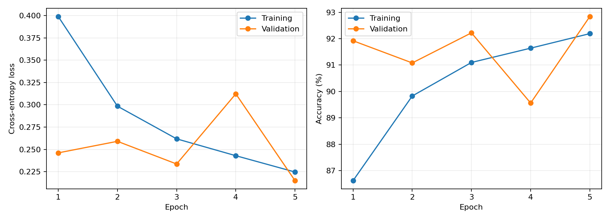
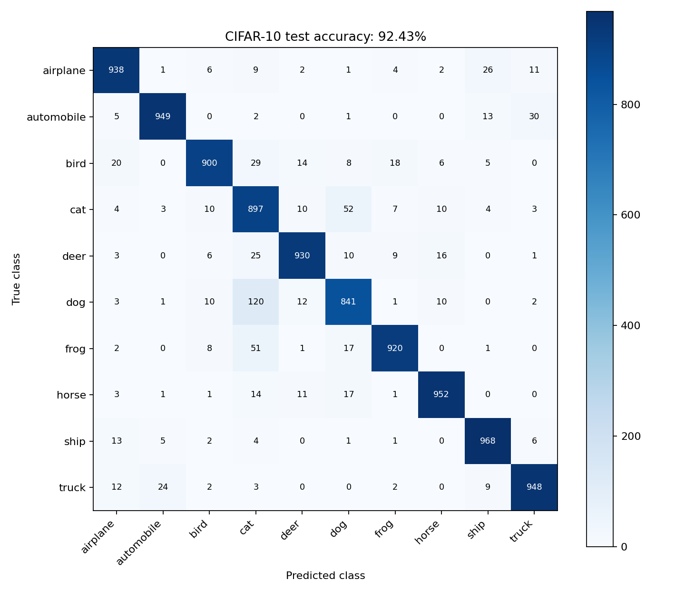
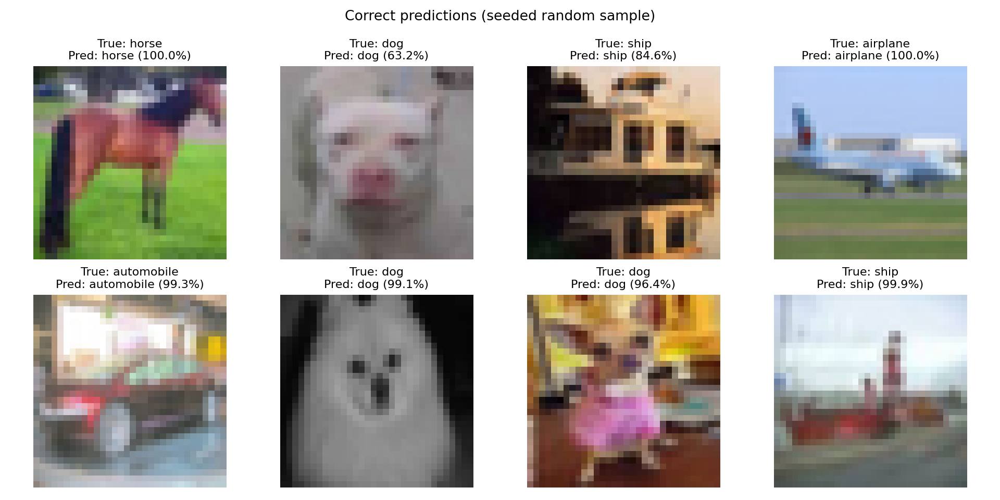
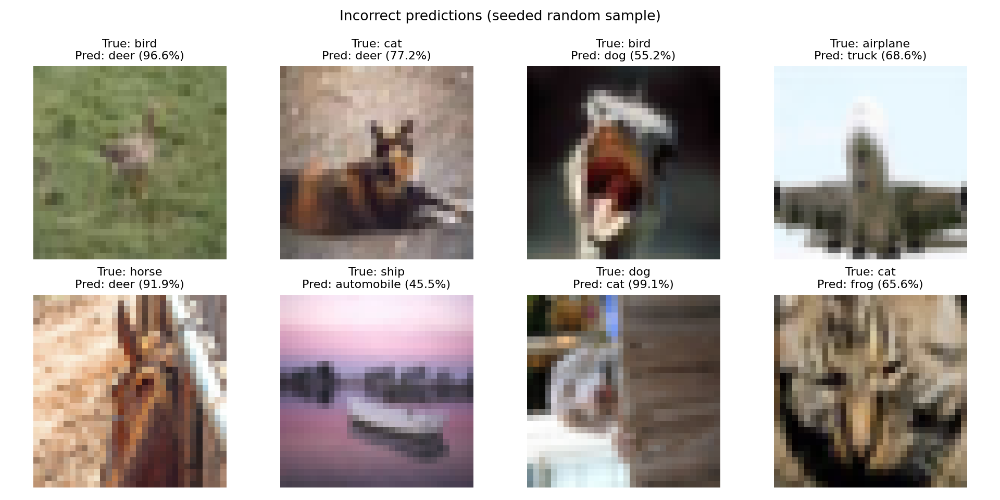

# 基于预训练 ViT 的 CIFAR-10 图像分类

这个项目使用 PyTorch 在本机 GPU 上微调预训练的 Vision Transformer（ViT Tiny），完成 CIFAR-10 十分类。项目按数据、训练、评估三个阶段组织，便于学习完整的图像分类工作流程。

## 第 1 步：准备本地环境

在 VS Code 中打开本文件所在文件夹，并打开终端。此电脑的 Miniconda 基础环境已安装可用的 GPU 版 PyTorch。下面的命令建立一个项目虚拟环境，复用基础环境中的 PyTorch，并把新依赖安装在项目环境中：

```powershell
python -m venv --system-site-packages .venv
.\.venv\Scripts\python.exe -m pip install --upgrade pip
.\.venv\Scripts\python.exe -m pip install -r requirements.txt
.\.venv\Scripts\python.exe scripts/check_environment.py
```

最后一条命令应显示 `CUDA available: True` 和 `GPU calculation: 6.0`。在 VS Code 中用 `Ctrl+Shift+P` → `Python: Select Interpreter` 选择本项目的 `.venv`。

`--system-site-packages` 意味着这个虚拟环境能够读取基础环境的软件包，因此它不是完全隔离的。换电脑复现时，建议使用普通 `python -m venv .venv`，然后按 [PyTorch 官方安装页面](https://pytorch.org/get-started/locally/) 为该环境安装 GPU 版 PyTorch，再安装 `requirements.txt`。本机已验证 PyTorch 2.7.0+cu128、torchvision 0.22.0+cu128、timm 1.0.30 与 RTX 5060 Laptop GPU 可用。

## 第 2 步：认识数据集

[CIFAR-10](https://cave.cs.toronto.edu/kriz/cifar.html) 有 10 类、60,000 张 32×32 彩色图片。官方划分为 50,000 张训练图和 10,000 张测试图；本项目从官方训练集再固定划出 5,000 张作为验证集，因此实际使用 45,000 张训练、5,000 张验证、10,000 张最终测试。测试集不参与模型选择。

在项目根目录运行：

```powershell
.\.venv\Scripts\python.exe scripts/preview_data.py
```

首次运行会下载约 170 MB 的数据，完成后生成 `runs/data_preview.png`：每类一张原始图片。`data/` 和 `runs/` 已被 Git 忽略，不会误传到 GitHub。

如果官方下载很慢，可使用 [Zenodo 上的原始文件副本](https://zenodo.org/records/10089977) 下载。下面的命令支持接着已有 `.part` 文件下载；数据集已经就绪时无需执行：

```powershell
curl.exe -L --fail --retry 5 -C - -o data\cifar-10-python.tar.gz.part "https://zenodo.org/records/10089977/files/cifar-10-python.tar.gz?download=1"
$hash = (Get-FileHash data\cifar-10-python.tar.gz.part -Algorithm MD5).Hash.ToLower()
if ($hash -ne 'c58f30108f718f92721af3b95e74349a') { throw "数据文件校验失败：$hash" }
Move-Item data\cifar-10-python.tar.gz.part data\cifar-10-python.tar.gz
.\.venv\Scripts\python.exe scripts/preview_data.py
```

下载中断时，重新执行第一行即可续传。只有校验通过才执行后面的 `Move-Item`；若使用 PowerShell 逐行运行，校验失败后不要继续执行最后两行。

## 第 3 步：训练模型

模型为 [`vit_tiny_patch16_224.augreg_in21k_ft_in1k`](https://huggingface.co/timm/vit_tiny_patch16_224.augreg_in21k_ft_in1k)：先在 ImageNet-21k 预训练、再在 ImageNet-1k 微调的 ViT Tiny。我们将分类头替换为 10 类输出后，对全部参数进行微调。实际模型约 553 万参数：224×224 输入切成 196 个 16×16 图像块，使用 192 维嵌入、12 层 Transformer、每层 3 个注意力头，最后通过分类头输出 10 类分数。

训练时先对 32×32 原图随机裁剪（边缘填充 4 像素）和水平翻转，再放大到 224×224；验证和测试只调整大小。三个通道均使用 mean=0.5、std=0.5 归一化，与该预训练权重配置一致。

先进行小规模试跑，检查整个流程；**试跑准确率不是最终结果**：

```powershell
.\.venv\Scripts\python.exe -m src.train --epochs 1 --batch-size 8 --workers 0 --max-train-batches 2 --max-val-batches 2 --run-dir runs/smoke
```

确认试跑完成后运行完整训练：

```powershell
.\.venv\Scripts\python.exe -m src.train --epochs 5 --batch-size 32 --workers 0 --run-dir runs/vit-tiny
```

程序会逐轮输出训练与验证损失、准确率，保存最佳验证模型到 `runs/vit-tiny/best.pt`，并保存每轮记录到 `runs/vit-tiny/history.json`。如遇 GPU 显存不足，把 `--batch-size 32` 改为 `16` 或 `8`。

## 第 4 步：独立测试与图表

完整训练后执行下面的命令，加载最佳验证模型，评估 10,000 张测试图片。它不会重新训练或下载预训练权重：

```powershell
.\.venv\Scripts\python.exe -m src.evaluate --checkpoint runs/vit-tiny/best.pt --output-dir reports
```

程序生成测试指标、混淆矩阵、训练曲线，以及各 8 张预测正确和错误的示例。示例在相应集合内以固定种子随机抽取；图中的百分比是模型预测类别的 softmax 分数，不代表预测一定正确。

## 实测结果

本次实验在 RTX 5060 Laptop GPU 上运行，使用 AdamW（学习率 0.0003、weight decay 0.05）、batch size 32、混合精度和随机种子 42，训练 5 轮。以验证准确率选择模型，选中了第 5 轮。

| 指标 | 结果 |
| --- | --- |
| 最后一轮训练准确率（含随机增强） | 92.19% |
| 最佳验证准确率（5,000 张） | 92.84% |
| 独立测试准确率（10,000 张） | **92.43%** |
| 测试正确 / 错误数量 | 9,243 / 757 |

训练损失整体下降；第 4 轮验证准确率出现波动，第 5 轮恢复。仅凭记录无法确定波动原因。测试中较多的错误是狗被识别为猫（120 张）以及猫被识别为狗（52 张）；狗这一类召回率为 84.1%。原图分辨率低、外观相近等因素可能增加识别难度，这些原因属于对结果的分析。









原始指标见 [test_metrics.json](reports/test_metrics.json)，每轮记录见 [training_history.json](reports/training_history.json)。这是一次固定划分、固定种子的实验结果；预训练数据和训练方式与从零训练模型不同，比较结果时应注明这些条件。

## 文件与复现

- `src/data.py`：图像处理和训练/验证划分。
- `src/model.py`：构建预训练 ViT 和十分类头。
- `src/train.py`：训练、验证并保存最佳模型。
- `src/evaluate.py`：独立测试与图表生成。
- `reports/`：可随仓库分享的实验结果。
- `runs/`、`data/`、`.venv/`：本地权重、数据和环境，Git 已忽略。

模型权重未包含在 Git 仓库内，复现评估前需要先运行训练命令。不同硬件与非确定性 GPU 运算可能造成细小差异。代码测试命令：

```powershell
.\.venv\Scripts\python.exe -m pytest -q
```
